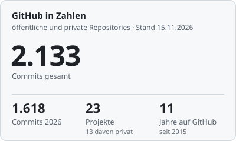
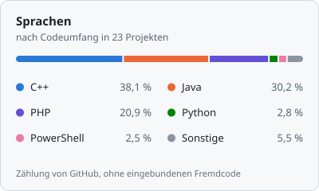

*Tools, die Streams laufen lassen – rund um die Uhr, sicher und ohne Babysitting.*

---

## 📊 GitHub in Zahlen

<!-- stats:start -->
<!-- Dieser Block wird von scripts/Statistik-aktualisieren.ps1 geschrieben – Änderungen hier gehen beim nächsten Lauf verloren. -->

<picture>
  <source media="(prefers-color-scheme: dark)" srcset="assets/stats-dark.svg">
  
</picture>
<picture>
  <source media="(prefers-color-scheme: dark)" srcset="assets/languages-dark.svg">
  
</picture>

<!-- stats:end -->

Gezählt werden meine Commits auf den Hauptzweigen aller eigenen Repositories – öffentlicher und privater. 
Der Code von StreamWizard bleibt privat, die Zahlen nicht.

---

## 🧙 StreamWizard

StreamWizard ist meine Plattform für Streaming-Automatisierung auf **Twitch**, **Kick** und **Discord**:
ein 24/7-Streambot direkt in OBS, Live-Untertitel mit Übersetzung, eine zentrale Runtime für Discord,
Gewinnspiele und Statistiken – und dahinter eine Website mit Login, Lizenzen und Zahlung.

> 🔒 StreamWizard ist proprietär. Der Quellcode ist nicht öffentlich – bei Fragen einfach schreiben.

| Baustein | Was es tut | Technik |
|:---|:---|:---|
| 🎬 **OBS-Plugin** | 24/7-Streambot als Modul **direkt in OBS Studio** – Playlisten, Ansage des laufenden Videos im Chat, signierte Selbst-Updates | C++20 · Qt 6 · libobs |
| 💬 **CaptionBridge** | Live-Untertitel: erkennt die gesprochene Sprache lokal auf dem Streaming-PC und übersetzt sie – für die Twitch-Extension und als Overlay in OBS | C++20 · Qt 6 |
| 🤖 **StreamwizardNode** | Zentrale Runtime: Discord-Gateway, Gewinnspiele und Streamstatistik über einen gemeinsamen Twitch-IRC-Hub | Java 21 · JDA · Twitch4J · kick4j |
| 🌐 **streamwizard.de** | Website und REST-API, Login über Discord, Twitch und Kick, Lizenzen und Zahlung | PHP 8.5 · MariaDB · Stripe |
| 🔐 **Loginserver** | Login für Zuschauer über Twitch | Java 21 |
| 💼 **Admintool** | Oberfläche für den Supportchat | Java 21 · Swing · FlatLaf |
| 🔑 **TokenTool** | OAuth-Tokens für Twitch und Discord einrichten und prüfen | Java 21 · Swing · FlatLaf |
| 📥 **SE-Import** | Punkte und Watchtime aus StreamElements übernehmen | Java 21 · Swing · FlatLaf |

### 🔄 Aus alt wird neu

Die früheren Einzel-Bots sind zusammengewachsen – weniger Prozesse, weniger Fehlerquellen:

- **RaffleBot Java**, **StreamStats Java** und **EventTool** → aufgegangen im zentralen **StreamwizardNode**
- **OBS Bot Java** (über obs-websocket) → ersetzt durch das native **C++-OBS-Plugin** *(seit September 2026)*
- **Updater** → eingestellt, das OBS-Plugin aktualisiert sich selbst *(seit September 2026)*

---

## 🌍 Öffentliche Projekte

| Projekt | Worum es geht | Technik |
|:---|:---|:---|
| 🧱 **[Baumeister](https://github.com/Blackn0va/baumeister)** | Minecraft-Plugin: ein Baumeister, der auf Zuruf baut, und Vera, eine Begleiterin, die mit dir spricht – lokale KI, Schematics, Redstone, Städte aus OpenStreetMap | Java 21 · Paper · llama.cpp · C++20 |
| 💡 **[LichtDuell](https://github.com/Blackn0va/LED_Game)** | Farbduell auf dem WLAN-LED-Streifen – der Computer schießt, du schießt zurück, Endgegner inklusive | C++20 · Govee · WLED · Art-Net · sACN |
| 📡 **[Marauder Control Center](https://github.com/Blackn0va/ESP32_Control_Center)** | Steuerung und Firmware-Flasher für den ESP32 Marauder direkt im Browser – für autorisierte Sicherheitstests | HTML · JavaScript · Web Serial |
| 🐬 **[Flipper BadUSB Wrapper](https://github.com/Blackn0va/Flipper_BadUSB_Wrapper)** | Verpackt PowerShell-Skripte als BadUSB- und JavaScript-Payload für den Flipper Zero | C# |
| 🤖 **[Discord Bot](https://github.com/Blackn0va/Discord_Bot)** | Discord-Bot mit OpenAI-Chat, Befehlen, Rollenvergabe und Musik | Java |
| 🖨️ **[RICOH-Benutzerliste](https://github.com/Blackn0va/RICOH_userlist_csv_ActiveDirectory)** | Erzeugt die CSV-Benutzerliste für RICOH-Drucker aus dem Active Directory | C# |
| 📝 **[Übergabeprotokoll](https://github.com/Blackn0va/Uebergabeprotokoll)** | Übergabeprotokoll als PDF zum Unterschreiben, mit SQLite-Datenbank | C# |

---

## 🧰 Tech-Stack

**Sprachen & Frameworks**

**Plattformen & Dienste**

**Build & Tools**

---

## 🔐 Worauf ich Wert lege

- **Sicherheit zuerst** – OWASP Top 10 und ASVS als Maßstab; Login, Lizenz und Zahlung auf Level 2
- **Fail-closed** – bei Fehlern wird angehalten, nicht stillschweigend weitergemacht
- **Signierte Releases** – Updates und Downloads mit eigener Signatur, Signierschlüssel auf Hardware-Token
- **Signierte Schnittstellen** – die Kommunikation zwischen den Diensten ist per HMAC abgesichert
- **Belegen statt raten** – jeder Fix braucht einen Test, der ohne ihn scheitert

---

## 🖥️ Nebenbei: IT-Administration

Windows-Clients und -Server, Automatisierung mit **PowerShell**, Geräteverwaltung mit **Intune**,
**Azure** und **Microsoft 365**.

---

### 📬 Kontakt

Idee für ein Stream-Tool, Frage zu StreamWizard oder einfach Austausch?
Schreib mir: **[blacknovaa@gmail.com](mailto:blacknovaa@gmail.com)**

Made with ❤️ for the Streaming Community

